# 艾泽拉斯：裂隙远征

> 魔兽世界同人 · 像素风 · 动作肉鸽网页游戏  
> **WARCRAFT: RIFT EXPEDITION** · v0.13.1
>
> 详细更新见 [CHANGELOG.md](CHANGELOG.md)

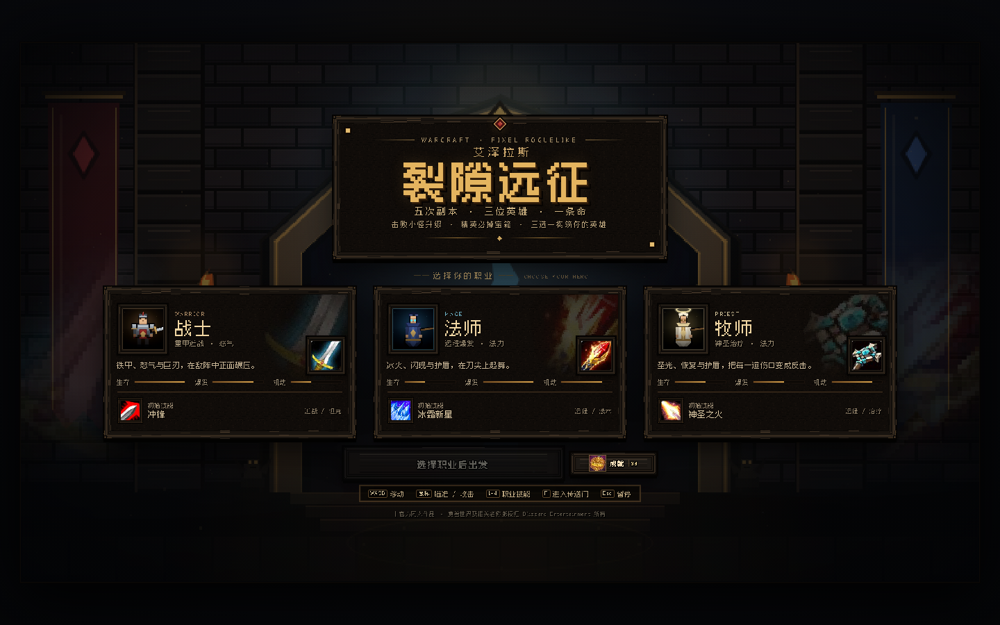

扮演**法师**，带着固定的四个技能穿过五个被裂隙吞噬的魔兽世界副本，清理小怪、收集经验、开启精英宝箱。**每次升级、开箱与击败首领都会进入「三选一」**，用技能升级、被动天赋、联动符文、首领遗物与诅咒交易组成 build，最终在冰冠堡垒挑战巫妖王。

这是一个**零依赖、纯前端、可离线运行**的完整小游戏：像素角色、场景、特效与音效均由代码实时生成；UI 使用本地化的 9-slice 像素纹理与 Fusion Pixel 中文字体；技能、职业与首领图标使用本地化的魔兽世界官方图标资源（详见 [assets/README.md](assets/README.md)）。

> 想快速分享给朋友：直接用 `dist/` 或 `release/rift-expedition.zip`，部署步骤见 [DEPLOY.md](DEPLOY.md)。

---

## v0.13.1 敌人节奏与鼠标瞄准

- **怪物更耐打**：普通怪基础生命 ×1.55；首领基础生命 ×1.25。
- **怪物更慢**：普通怪移动速度 ×0.72；首领移动速度 ×0.85，冲锋与追击不再轻易贴脸。
- **自动攻击改为鼠标方向**：开启 `AUTO` 或松开左键后，普攻始终沿鼠标当前方向发射，不再自动锁定最近敌人；按住左键仍是同一方向的手动射击。
- 技能栏提示、操作说明与 `AUTO` 按钮标题同步更新。

## v0.13.0 连锁爽感

这一版专门解决“能打，但不够爽”的问题，核心是**连续击杀的即时反馈**：

- **连锁击杀**：2.6 秒内连续击杀会累积连锁，HUD 显示 `xN` 与剩余时间。
- **越连越强**：每层连锁提供伤害加成（最高 15 层），并让普攻与技能更容易滚起雪球。
- **击杀回蓝**：每次击杀回复 3.5% 最大法力，并减少所有技能 0.28 秒冷却。
- **奥术过载**：每 5 连杀自动触发一次大范围奥术爆炸，击退周围敌人，回复法力，并触发紫金屏闪、震屏和命中数字。
- **击杀手感**：普通击杀增加短 hitstop、震屏、更大粒子爆裂和 `xN` 飘字；10 连以上进入紫色过热状态。
- **节奏加速**：
  - 普攻伤害 14 → 16，间隔 0.5 → 0.42；
  - 移速 86 → 92，法力回复 7 → 8.5；
  - 冰霜新星 / 闪现 / 寒冰护体 / 烈焰风暴冷却分别降至 7 / 5 / 10 / 8 秒；
  - 普通宝箱概率 2.5% → 3.5%。
- **结算记录**：结算页新增“最高连锁”。

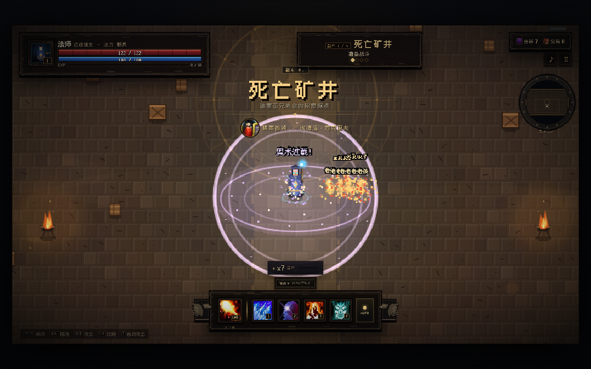

## v0.12.0 法师单职业 + 固定四技能

这一版收缩为单职业构筑原型，先把“技能成长”跑通：

- **移除战士与牧师**：职业数据、标题职业卡、职业成就与相关首领遗物均已从当前版本移除；当前只保留法师。
- **法师固定四技能**：开局即拥有**冰霜新星、闪现、烈焰风暴、寒冰护体**，不再在升级中抽取新主动。
- **技能升级三选一**：每个固定技能有两条升级路线、两级成长；满级后不再出现该技能升级。
- **升级保底**：只要还有可升级技能，三选一至少出现一张技能升级卡；诅咒不会替换这张保底卡。
- **被动继续掉落**：法师被动、通用被动与联动符文仍然进入升级池。
- **构筑可见**：暂停面板的主动技能图标会显示 T1 / T2 升级标记。
- **界面同步**：标题、职业卡、成就页与 README 均改为法师单职业。


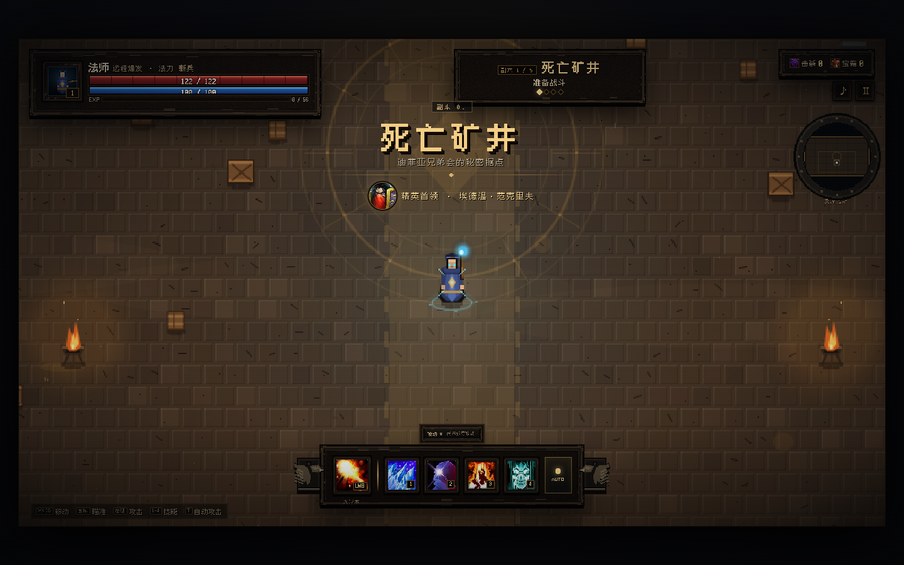

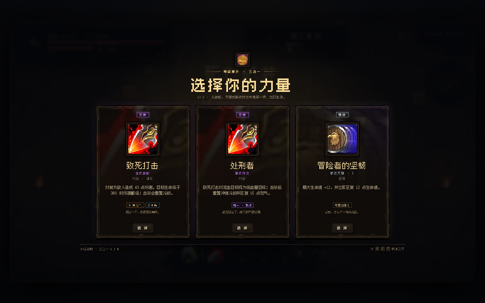

## v0.11.0 构筑 2.0：首领遗物 / 诅咒交易 / 刷新

这一版不再只加数值，而是加入能改变一整局玩法的高权重选择：

- **5 件首领遗物**：每击败一个副本首领，在宝箱奖励之后额外触发一次**遗物三选一**。遗物整局生效、不可重复，包含鲜血契约、不屈壁垒、风暴之眼、奥术过载与命运之骰。
- **4 张诅咒交易牌**：三选一中有概率出现红色诅咒牌，用明确代价换取高收益：狂徒、玻璃大炮、法力灼烧、孤注一掷。诅咒可拒绝，同一局最多承受 2 张。
- **刷新机制**：每局初始 1 次三选一刷新，可按按钮或 `R`；命运之骰额外提供 1 次。刷新对普通三选一和首领遗物都有效。
- **构筑可见**：暂停面板新增“遗物 / 诅咒”图标行，鼠标悬停可查看完整效果。
- **遗物实际生效**：伤害、生命、减伤、范围、冷却、消耗、吸血、过量治疗转护盾、救赎转化等均已接入战斗计算，不是只显示文字。

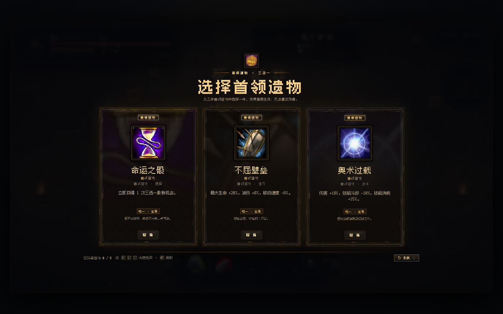

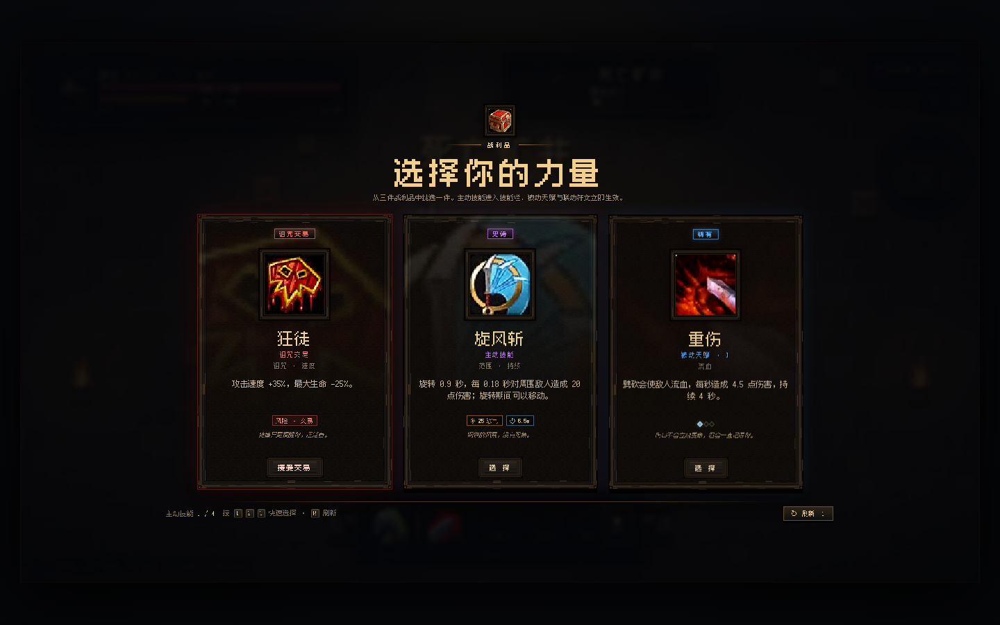

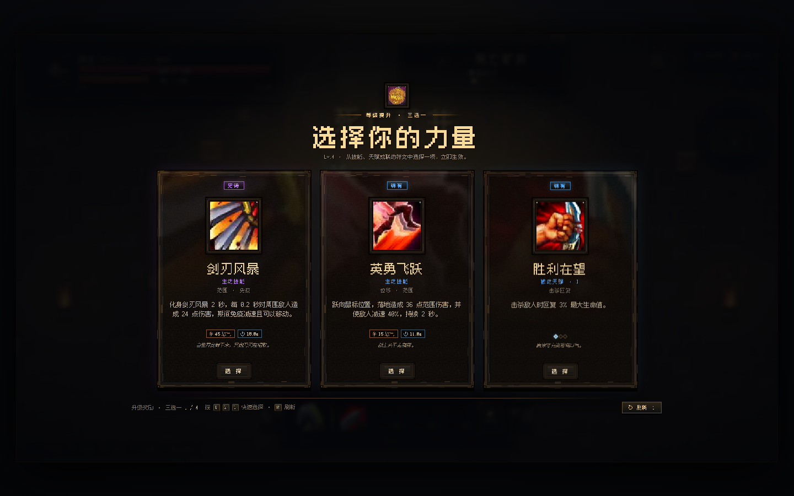

## v0.10.3 传送门自动进入

- **彻底移除 F 键**：不再有交互键、交互提示框和常驻交互按钮。
- **传送门自动触发**：首领宝箱选择完成后，传送门在宝箱附近的安全落点开启；玩家走入范围自动进入下一副本或离开裂隙。
- **防误触**：传送门不会压在宝箱/玩家脚下；生成时会寻找附近无障碍落点，并保留短暂离开范围后的触发保护。
- **提示同步**：移除标题、暂停和 HUD 中的 F 提示；新手提示改为“走入传送门自动进入下一副本”。

## v0.10.2 全局暗石 UI

上一版只修了成就页，这次把同一套材质语言铺到所有界面，彻底去掉“金色网页框”：

- **全局去掉游戏窗口连续外框**：标题、战斗、三选一、暂停、结算页都不再套一整圈金色矩形；屏幕边缘交给暗色背景与各面板自己的角饰。
- **重绘全局 9-slice**：`panel_heavy`、`slot_heavy`、`button_heavy_gold`、`button_heavy_stone` 全部改为暗石、铁灰、旧铜，只在角部铆钉和短角饰保留金色。
- **HUD / 技能栏 / 提示 / 弹窗 / 暂停 / 结算**统一压暗：血条、资源条、Boss 条的金色外圈改成深铜色；按钮只保留顶部一小段暖金。
- **职业卡与三选一卡**去掉最外层 1px 彩色直线，改由暗石 9-slice 框、四角旧金与稀有度柔光承担层次。
- **小地图圆环与技能栏狮鹫端饰降饱和**：不再用大面积亮金圈抢视线。
- **成就页保持暗石板方案**，并与新 HUD、按钮、图标框统一。


暂停与结算：[pause.png](screenshots/pause.png) · [end.png](screenshots/end.png)

## v0.10.1 成就界面重绘

这次针对成就界面“金色直线太多、像网页框”的问题，重新做了一套暗石与旧金结合的边框：

- **去掉整圈高亮金边**：成就面板改用暗石 9-slice 外框，金色只保留在四角雕花、铆钉和图标框上。
- **去掉全窗口连续外框**：打开成就界面时隐藏游戏外框，只留下成就面板自身的石质边框，避免大面积金色矩形抢走主题。
- **卡牌改成暗色石板**：不再使用整圈金色边框；解锁状态只增加暖色内光与角部旧金，锁定状态保持冷暗石面。
- **筛选按钮、统计块、页脚分隔线**同步降噪：标题与内容重新成为视觉中心。
- **新增生成贴图**：暗石面板、卡牌框、石纹、雕花分隔线、战团徽记，全部由 `tools/generate_achievement_assets.py` 用 Pillow 生成，不引入外部素材。

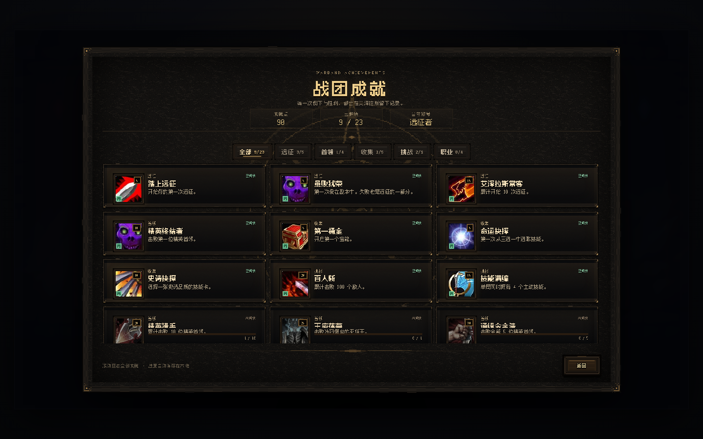

## v0.10 自动攻击与普攻构筑

这一版让左键从“必须一直按住”变成真正的战斗循环，并给法师普攻加入可成长的构筑方向：

- **自动攻击默认开启**：松开鼠标后会按**鼠标方向**自动射击，不再自动锁定敌人；按住左键也可以手动射击，方向一致。
- **开关方式**：按 `T`，或点击技能栏右侧的 `AUTO` 按钮。
- **无目标不空放**：没有敌人在射程内时不会自动开火，仍可按住左键向指定方向射击。
- **法师普攻三件套**：
  - **火球精通**：火球伤害 +22%/级，体积 +18%/级，最高 3 级。
  - **急速咏唱**：火球攻击速度 +16%/级，最高 3 级。
  - **分裂火球**：额外发射 1/2 枚分裂火球，每枚造成 62% 伤害，最高 2 级。
- **数值联动**：火球体积同时影响碰撞范围与视觉尺寸；分裂火球继承点燃、法力和命中效果。
- **被动栏可见**：三个普攻被动会出现在顶部被动栏，并可在升级三选一中重复提升。

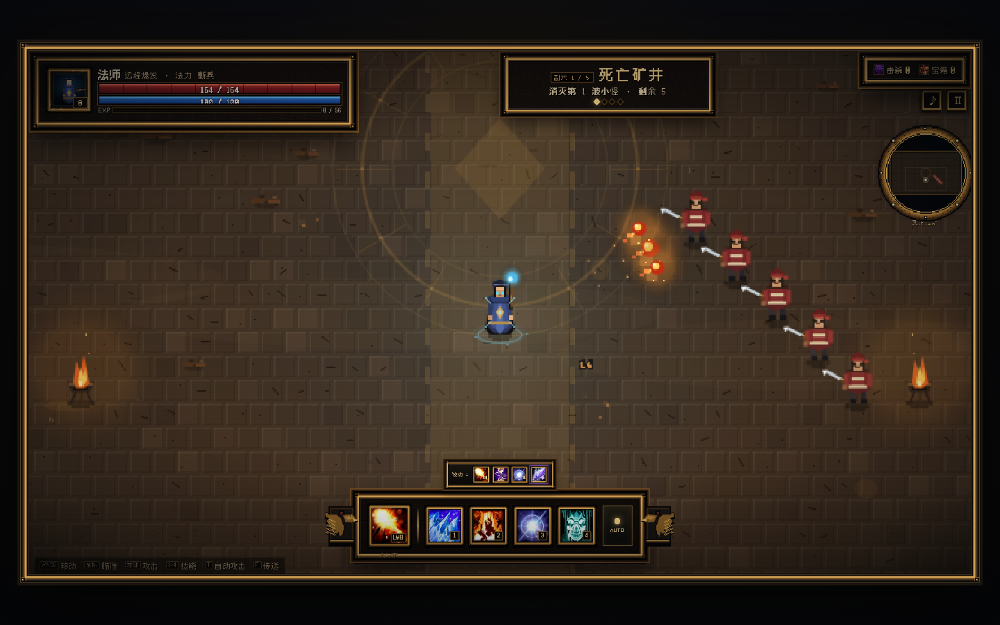

## v0.9.1 地图障碍与可破坏道具

之前地图上其实已经有木桶、木箱、墓碑、水晶等装饰物，但它们只是画上去的，没有碰撞、不会挡路、也不能互动。这一版把它们做成了真正的地图生态：

- **实心障碍**：木桶、木箱、铁砧、石柱、碎石堆、墓碑、水晶、武器架、火盆都会挡住玩家、敌人和弹道。
- **可破坏道具**：木桶和木箱有独立生命值，战士近战、范围技能、法师/牧师弹道都能打碎；碎裂后留下残骸并掉落经验。
- **地图掩体**：远程怪和玩家的弹道都会被实心障碍挡住，走位和卡视角开始有意义。
- **安全生成**：玩家出生点、怪物刷怪点、宝箱掉落点和首领出生点都会避开障碍物。
- **多轮推出碰撞**：角色被两个相邻障碍夹住时会连续解算，不容易卡死。
- **地图数量**：每个副本约 18 个道具，其中石柱、碎石堆、铁砧、火盆等构成主要障碍；木桶/木箱提供可破坏的战术资源。

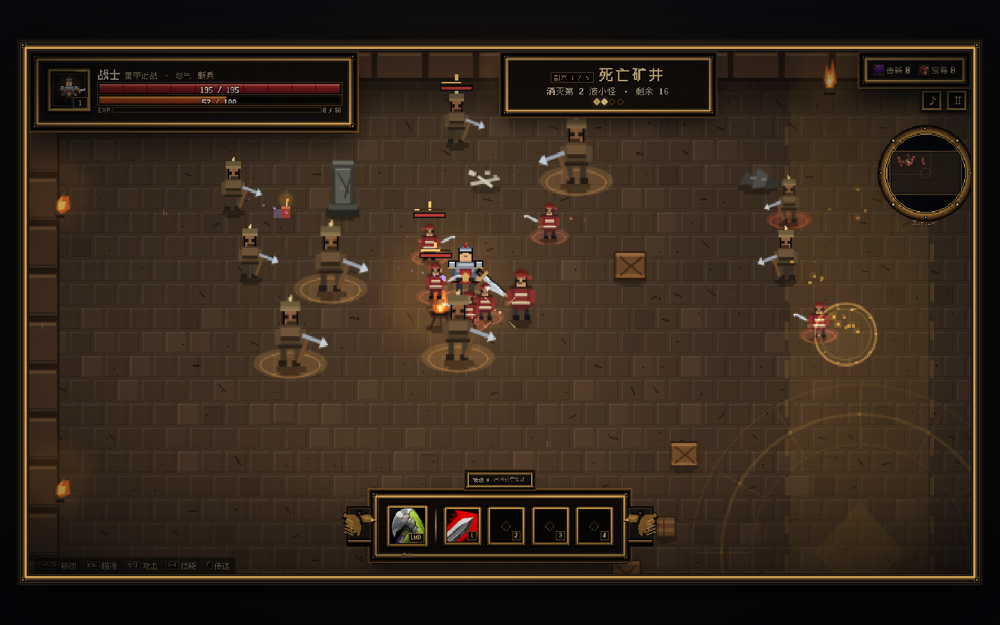

## v0.9 技能特效重制

这一版把技能特效从“一个圆 + 一个闪光”改成有层次、有材质、有命中反馈的像素特效：

- **环形技能**：外辉、内环、像素刻度、旋转符文点，使用加法混合，扩张时不再只是一条细线。
- **挥砍技能**：宽光带、白色刃光、刃口火星三层叠加，并保留短暂残影。
- **地面符文**：神圣新星、真言术盾、恢复、冰霜新星、寒冰护体、奥术爆炸、烈焰风暴都会在地面留下旋转符文。
- **命中反馈**：所有非持续伤害命中都会生成放射状冲击星；重击和首领命中更大。
- **弹道重做**：火球、冰霜、暗影、毒、神圣、苦修、炸药分别有独立的核心、光晕、拖尾和环绕粒子。
- **闪现**：起点到终点留下奥术光轨与落点符文。
- **性能上限**：同时最多保留 80 个技能特效、520 个粒子，怪潮中不会无限堆积。

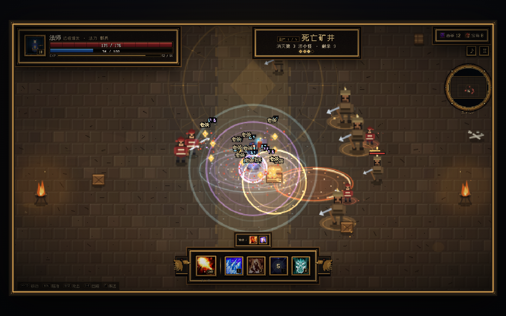

## v0.8 怪潮生态：更多、更快、更分工

这一版不是单纯把数字调大，而是把怪群拆成真正需要应对的角色：

- **每个副本 6–8 种敌人**：普通近战、高速群怪、重型蛮兵、远程施法者、冲锋怪、自爆怪，以及精英头目；不同副本按自身主题组合。
- **移动速度明确分层**：
  - 群怪 / 游魂：约 **100–115**，速度快、血量低，负责压迫走位。
  - 冲锋怪 / 猎犬：约 **68–84**，会蓄力突进。
  - 远程施法者：约 **44–50**，会拉开距离。
  - 重型蛮兵 / 憎恶：约 **28–35**，慢、厚、重击有前摇。
- **单波数量继续提升**：第一副本约 **11 / 17 / 21** 只，后期副本约 **13 / 18 / 23** 只；每个副本小怪总量约 **49–54** 只。
- **精英头目**：金色光环、王冠标记、更高血量与经验，只在高波次出现。
- **自爆怪**：会贴近后引信爆炸，也会在死亡时爆炸，必须提前处理。
- **视觉辨识**：体型、光环颜色、精英王冠、引信红圈与高速拖影，让玩家一眼分辨快怪、慢怪和危险怪。

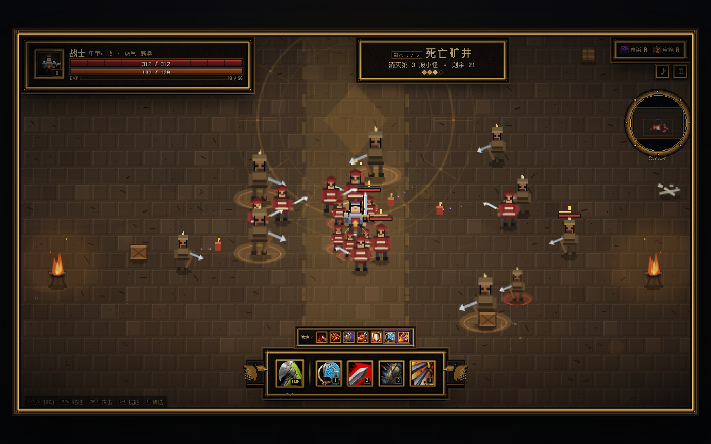

## v0.7.2 苦修重做与移动施法

你说得对：在肉鸽里把技能做成“原地引导几次治疗”，等于用生存换几口固定回血，既没有走位价值，也没有瞄准价值。这一版把这类引导重新设计：

- **苦修不再引导、不再罚站**：改为瞬间朝鼠标方向射出 **3 道扇形圣光**，每道造成神圣伤害并回复生命；施放不减速，可以边走边打。
- **距离与角度成为技巧**：贴脸或中距离能让多道圣光同时命中，远距离则会散开；既能打爆发，也能靠命中回血。
- **旋风斩 / 剑刃风暴改为移动施法**：旋转期间可以移动（速度约为正常的 78%），可以追着敌人转，而不是站在原地等引导结束。
- **保留“引导”的风险感**：旋风斩/剑刃风暴仍需靠近敌人，但不再剥夺走位；苦修则完全改为移动爆发。

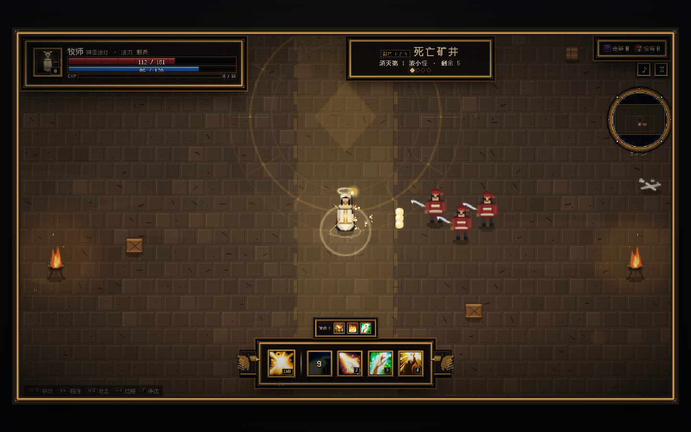

## v0.7.1 升级三选一与触碰开箱

这一版把两个影响节奏的交互补完整：

- **升级三选一队列化**：每次升级都会进入一次独立的三选一；连续升多级时逐次展示，不会因为状态切换而漏掉。升级界面明确标注「等级提升 · 三选一」，并显示还有几次升级待选择。
- **触碰宝箱自动开启**：不再需要按 F。角色碰到宝箱即自动打开并进入战利品三选一；普通宝箱、首领宝箱都适用。
- **传送门走入自动进入**：当前副本清空后，传送门会在首领宝箱附近开启；走入范围即自动进入下一层，不再需要按 F。
- **提示文案同步**：标题操作提示、游戏内提示、开局 Toast 与 README 均已更新。


## v0.7 圣光之誓：牧师

第三职业 **牧师** 加入远征。它不是“换皮法师”，而是一个围绕**治疗、护盾与神圣伤害**运转的职业：

- **惩击**：远程圣光普攻，稳定回复法力；牧师共有 6 个可获得主动技能，最多携带 4 个。
- **神圣之火**：圣光火球，造成神圣伤害并留下灼烧。
- **真言术：盾**：获得高额护盾，争取站桩输出与读条空间。
- **恢复**：8 秒持续治疗；每跳都能触发「祝福」缩短神圣之火冷却。
- **神圣新星**：范围神圣伤害并自我治疗；恢复期间治疗量 +50%。
- **快速治疗 / 苦修**：前者瞬间抬血；后者瞬间射出三道扇形圣光，边走边打。
- **救赎**：神圣伤害按比例转化为治疗，让输出本身成为生存手段。
- **信仰恢复 / 专注意志 / 精神指引 / 心灵之火**：分别强化治疗、减伤、法力与神圣伤害。
- **联动符文**：
  - **祝福**：恢复每跳缩短神圣之火冷却，恢复期间神圣伤害 +12%。
  - **圣化**：神圣新星对带有恢复的目标额外治疗 35%，并延长恢复 2 秒。

牧师让“治疗”不再只是数值：恢复是神圣新星的增幅条件，护盾是站桩窗口，救赎把伤害转成治疗，祝福把持续治疗转成输出冷却。


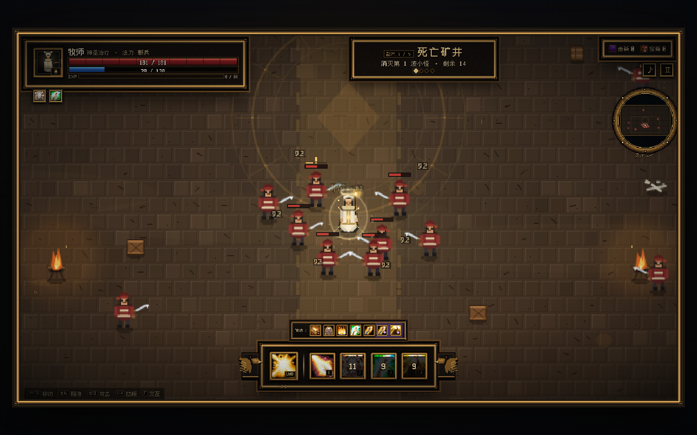

## v0.6 怪潮、被动 HUD 与技能联动

这一版针对“怪太少、被动看不见、技能只是数值堆叠”三个问题一起动刀：

- **怪潮加密**：单波数量从约 4 / 5 / 6 提升到 **6 / 8 / 10**；后期副本继续追加，单副本小怪总量约 24–30 只。
- **被动 HUD**：技能栏上方新增「被动」条，实时显示所有被动与联动符文的图标、等级与悬浮说明；不再只能暂停后查看。
- **联动符文**：新增 4 张职业符文（战士：血风暴、处刑者；法师：碎冰、元素回响），它们改变技能行为，而不是 +X% 数值。
- **基础元素联动**：
  - 火焰伤害击中被冻结目标 → **碎冰**，基础 +15%，装备「碎冰」符文后 +50% 并解除冻结。
  - 冰霜伤害命中燃烧目标 → **蒸汽**，基础 +12%，装备「元素回响」符文后 +35% 并刷新燃烧。
  - 旋风斩 / 剑刃风暴命中流血目标 → 基础 +12%，装备「血风暴」符文后 +30%、刷新流血并回复怒气。
  - 「处刑者」让致死打击把流血目标视为低血量目标，击杀后重置冲锋并回怒。
- **被动成为联动的起点**：重伤制造流血、点燃制造燃烧、冰霜碎片制造减速/冻结，再与主动技能或符文形成连锁，而不是孤立地加数值。

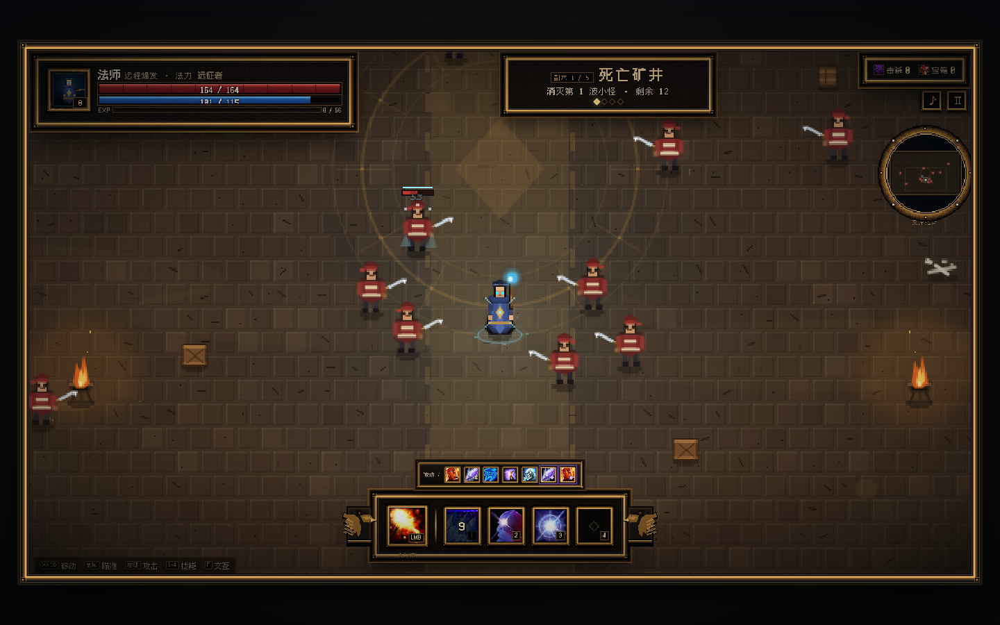

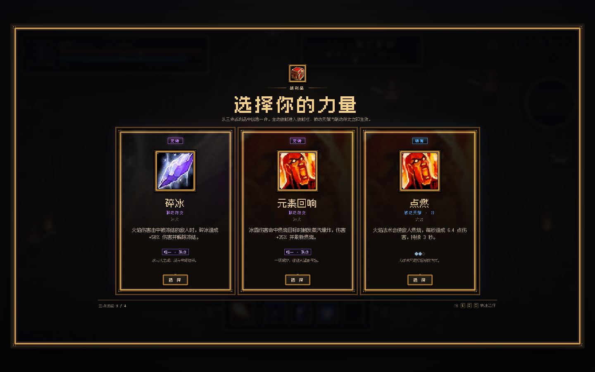

## v0.5.1 厚石铁边框精修

上一版虽然换上了像素纹理，但 9-slice 在 0.45–0.75cqw 的显示尺寸下把黄铜边压成了 **1px 金线**，外窗还保留着 1px 角线；近看仍然像矢量描边，而不是魔兽世界那种有体积感的石铁框。

这一版不再靠“加一圈亮边”解决，而是把边框当作结构件重做：

- **12px 石铁主体**：深色铁边 + 石质斜面 + 黄铜压条 + 窄金内嵌线 + 铆钉角板，所有主面板、标题铭牌、职业卡、卡牌、暂停/结算/成就面板统一。
- **满屏雕刻外框**：删除原来的 1px 角线，改用 12px 9-slice 外窗框，四角带实体角板。
- **按钮与槽位加厚**：主按钮、卡牌选择、成就筛选、技能槽、头像框、成就图标框全部换成厚框，不再出现细金线按钮。
- **成就卡改石质 plaque**：金色只保留在图标框和铆钉上，避免整页金边过载。
- **Toast / Tooltip / 交互提示** 一并加厚，避免局部仍残留细线。
- **响应式保留**：1280×720、1024×768 下已验证不溢出。


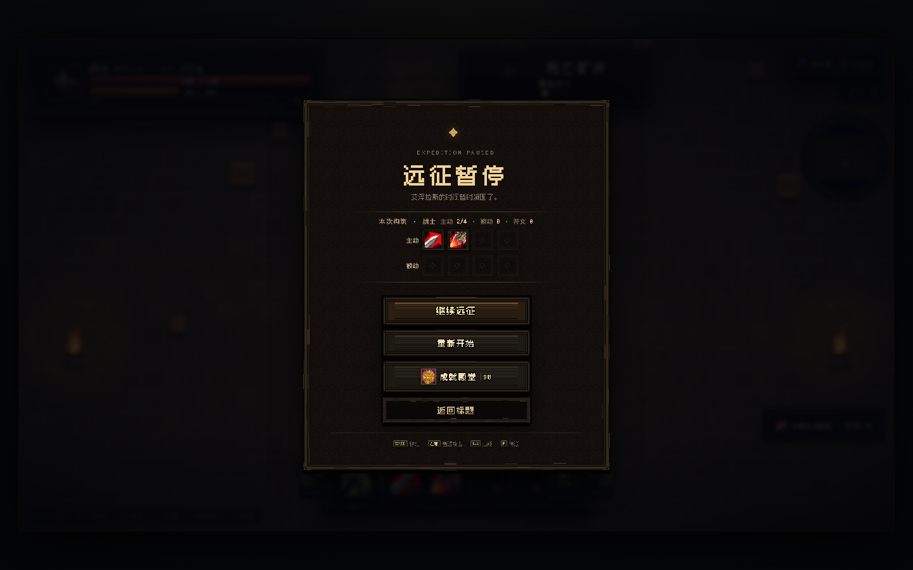

## v0.5 升级三选一

- **每次升级都触发三选一**：等级提升后游戏立即暂停，弹出「等级提升 · Lv.X」卡牌界面。
- **同一套技能池**：从当前职业的主动技能、被动天赋与通用天赋中抽取 3 项；遵守主动技能上限与被动最大等级。
- **连续升级链**：一次获得多级经验时，会连续弹出多轮三选一，直到所有升级奖励处理完毕。
- **开箱仍然独立**：宝箱沿用「战利品」三选一；首领宝箱选择后会先进入首领遗物三选一，再开启传送门。
- **成就弹窗避让**：三选一期间成就横幅会延后展示，不再遮挡卡牌。
- **兼容原有 build**：主动技能栏已满时不会再抽到主动技能；选择后立即刷新 HUD 与技能栏。


## v0.4 像素西幻 UI 重构

这一版针对“看起来像低清方块 UI，而不是魔兽世界像素风”做了整体重做：

- **真像素中文字体**：接入 OFL 授权的 Fusion Pixel 12px 字体，标题、按钮、HUD、卡牌与成就文字全部统一为像素字形。
- **手绘感 9-slice 像素边框**：不再使用平滑渐变面板，改为石质 / 皮革 / 黄铜三层像素纹理，带铆钉、内斜面、金色包边与厚重阴影。
- **魔兽式仪式感**：行动条两侧加入狮鹫纹章端饰，小地图改成黄铜圆环，玩家头像 / 技能槽 / 职业徽记全部使用独立的雕花框。
- **标题界面重做**：石砖大厅、尖拱门、两侧战旗、火把与地面符文，中央为金属铭牌与像素标题。
- **地面材质重做**：副本地板由明显的大方格替换为 16px 错缝石砖，带 1px 高光、阴影、裂缝与污渍。
- **信息密度调整**：职业介绍改为一句视觉化描述，更多信息交给徽记、图标、状态栏与颜色表达。
- **首领目标框重排**：从屏幕中央顶部移到玩家框下方，避免遮住首领本体与技能预警。
- **外框与铭牌**：整个游戏窗口、标题铭牌、暂停、结算、成就殿堂使用同一套像素金边体系。


## v0.3 战团成就

跨局保存的 23 项成就，记录你的每一次远征：

- **自动追踪**：首领击杀、通关、职业通关、宝箱、技能选择、等级、累计击杀、无伤首领等。
- **成就点与称号**：成就点会提升战团称号，从「新兵」一路到「艾泽拉斯传奇」，称号会显示在 HUD 与成就面板。
- **解锁提示**：达成成就时会在画面右侧弹出带技能/首领图标的成就横幅，并播放专属提示音。
- **成就殿堂**：标题界面与暂停菜单均可打开，支持按远征 / 首领 / 收集 / 挑战 / 职业筛选，显示进度条与解锁状态。
- **本地持久化**：保存在浏览器 `localStorage`，刷新页面不会丢失。
- **隐藏成就**：部分高难条件在解锁前不会显示具体内容。


---

## v0.2 视觉升级

- **真实魔兽技能图标**：战士、法师、牧师的主动技能与被动天赋全部换上本地化 WoW 技能图标，动作条、三选一卡牌与技能提示共用同一套视觉。
- **职业徽记与首领肖像**：标题职业卡、HUD 头像、副本入场横幅和首领血条加入职业徽记与首领肖像。
- **动态环境氛围**：五个副本分别加入矿尘、孢子、暗影雾、熔岩火星与飘雪，并配合主题色屏幕调色。
- **构筑查看面板**：暂停菜单展示当前主动技能与被动天赋图标、层数与槽位。
- **状态图标**：护盾、嗜血等状态改为图标 + 层数/剩余时间显示。
- **三选一卡牌视觉**：卡牌新增技能图标水印、消耗/冷却信息胶囊、被动等级菱形标记。
- **HUD 图标化**：击杀、宝箱、技能提示和战利品提示加入图标，减少纯文字信息。
- 保持原有零依赖、可离线运行方式。

---

## 快速开始

### 方法一：直接打开（最简单）

双击 `index.html`，用 Chrome / Edge / Safari 等现代浏览器打开即可。

### 方法二：本地静态服务器（推荐）

在项目根目录执行：

```bash
python3 -m http.server 8777
```

然后打开：

```text
http://127.0.0.1:8777/
```

无需安装 npm 依赖或构建步骤。

---

## 操作

| 按键 | 功能 |
| --- | --- |
| `WASD` | 移动 |
| 鼠标 | 瞄准 |
| 鼠标左键 | 手动瞄准普攻（按住连续攻击；松开后自动攻击仍按鼠标方向） |
| `T` | 开启 / 关闭自动攻击 |
| `1` `2` `3` `4` | 释放对应技能栏中的主动技能 |
| `R` | 三选一刷新（每局初始 1 次） |
| `Esc` | 暂停 / 继续 |
| 三选一界面 `1` `2` `3` | 快速选择卡牌 |

> 宝箱触碰自动开启；传送门走入范围自动进入，不需要交互键。

> 建议使用桌面浏览器与键盘鼠标。触屏设备会显示操作提示。

---

## 核心玩法

- **五个副本小关卡**：死亡矿井 → 哀嚎洞穴 → 影牙城堡 → 黑石深渊 → 冰冠堡垒。
- **三波小怪 + 精英首领**：每波小怪从场地边缘刷新，清空后进入下一波；第三波后首领登场。
- **小怪掉落经验**：击杀小怪掉落经验光球，靠近自动拾取，升级提升生命、伤害并回复部分状态。
- **宝箱掉落规则**：
  - 小怪：**2.5%** 概率掉落普通宝箱；
  - 精英首领：**100%** 掉落首领宝箱。
- **固定四技能**：法师开局即拥有冰霜新星、闪现、烈焰风暴、寒冰护体，不再在局内更换主动技能。
- **技能升级三选一**：只要还有可升级技能，升级/开箱至少出现一张已装备技能的升级卡；每个技能有两条路线，每条两级。
- **被动与符文继续掉落**：法师被动、通用被动和联动符文仍然补充构筑；满级技能不再进入升级池。
- **连锁击杀**：2.6 秒内连续击杀会叠加伤害、回蓝与冷却返还；每 5 连触发自动奥术过载。
- **永久死亡**：生命归零即本次远征结束，结算等级、击杀、宝箱、伤害与用时，并记录本地最佳成绩。
- **通关**：击败最终首领、开箱并进入传送门，即可完成五副本远征。

### 掉落与奖励节奏

每个首领宝箱至少提供一次成长；普通宝箱是额外惊喜。技能升级固定为两条路线、两级；被动天赋可以重复获取并升级，联动符文与首领遗物负责改变技能之间的反应。

---

## 职业与技能

当前版本只开发**法师**。法师以法力为资源，生命较低，依靠冻结、闪现、范围火焰与护盾作战。

### 固定四技能

| 技能 | 定位 | 升级路线 A | 升级路线 B |
| --- | --- | --- | --- |
| 冰霜新星 | 范围冻结 / 控制 | 寒冰脉冲：范围与伤害 | 深寒：冻结与冷却缩减 |
| 闪现 | 位移 / 短暂无敌 | 远行：距离与移速 | 迅影：冷却与法力回复 |
| 烈焰风暴 | 延迟范围爆发 / 点燃 | 灼热大地：范围与燃烧 | 集中轰击：集中伤害与冷却 |
| 寒冰护体 | 护盾 / 减伤 | 坚冰：护盾与额外减伤 | 持久：持续时间与移速 |

每个技能有**两条路线、两级成长**。第一次选择确定路线，第二次把该路线升到 II；满级后不再进入三选一。

**被动天赋**：奥术智慧、点燃、寒冰碎片、时间加速、屏障精通、法力涌动、火球精通、急速咏唱、分裂火球。

**联动符文**：碎冰、元素回响。

通用强化（冒险者的坚韧 / 磨砺 / 迅捷）会在技能池不足时作为保底选项出现。

---

## 副本与首领

| 副本 | 精英首领 | 主题 |
| --- | --- | --- |
| 死亡矿井 | 埃德温·范克里夫 | 火药、矿道与迪菲亚 |
| 哀嚎洞穴 | 唤醒者穆托斯 | 毒雾、洞穴与鱼人 |
| 影牙城堡 | 大法师阿鲁高 | 月影、狼人与暗影魔法 |
| 黑石深渊 | 达格兰·索瑞森 | 熔岩、铁锤与黑铁矮人 |
| 冰冠堡垒 | 巫妖王 | 冰霜、亡者与最终王座 |

首领拥有独立机制：重击预警圈、环形弹幕、召唤援军、冲锋与狂暴阶段。所有精英宝箱必定掉落。

### 战斗截图


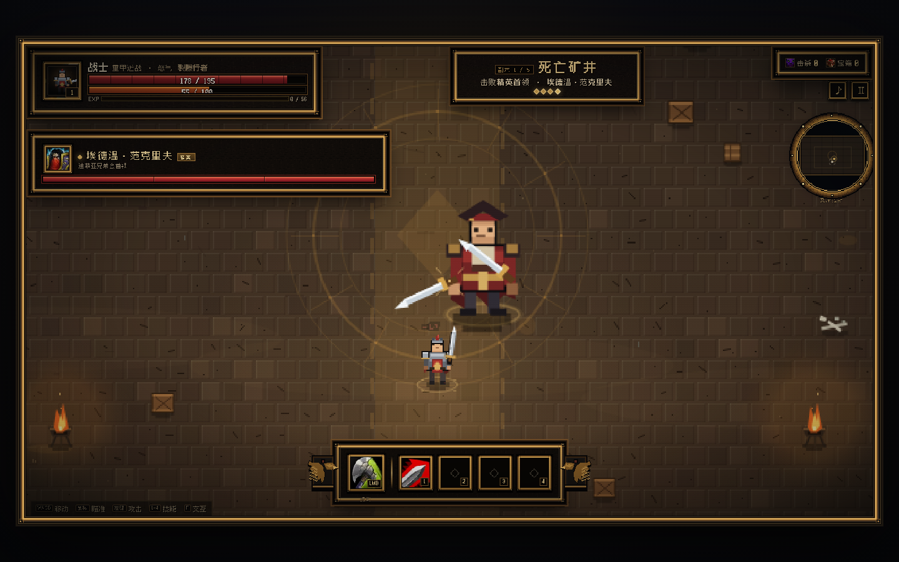


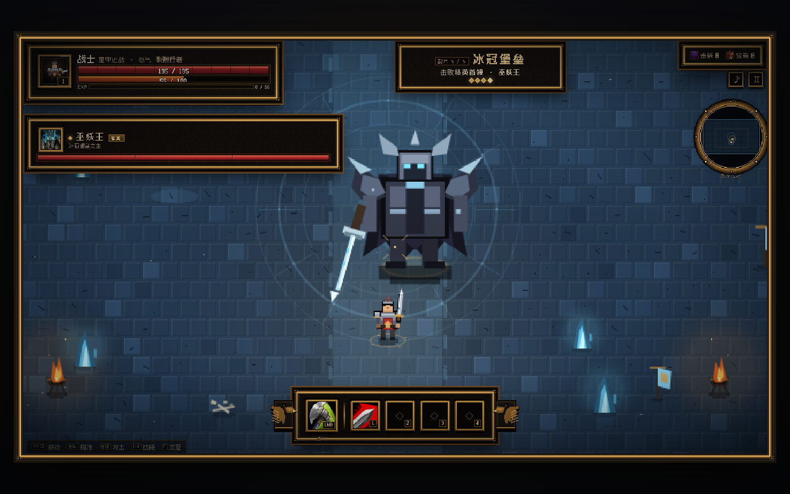

---

## 技术说明

- **纯原生 JavaScript**，无框架、无构建步骤、无 npm 依赖。
- **Canvas 640 × 360** 低分辨率渲染，再以最近邻缩放显示，保持像素颗粒感。
- **像素 UI 体系**：`pixel-skin.css` + `heavy-frames.css` + `assets/ui/` 中的 9-slice 石革金 / 厚石铁纹理；`tools/generate_ui_assets.py` 与 `tools/generate_heavy_frames.py` 可重新生成 UI 纹理。
- **像素字体**：`assets/fonts/fusion-pixel-zh_hans.woff2`，Fusion Pixel Font，SIL Open Font License 授权。
- **程序化像素美术**：`src/art.js` 中用矩形、多边形与 Canvas 绘制全部角色、首领、道具、特效与场景；未配置图标映射时会回退到程序化像素图。
- **本地化 WoW 图标**：`src/assets.js` 统一声明技能、职业与首领图标，`assets/` 内保存 56×56 本地图标，断网也能正常显示。
- **程序化音效与氛围音乐**：`src/audio.js` 使用 WebAudio 实时合成，无需音频文件。
- **界面**：HTML + CSS 覆盖层，使用容器查询单位保证整体缩放；支持暂停、结算、叙事横幅、技能提示、小地图等。
- **数据驱动**：职业、技能、副本、怪物与掉落参数集中在 `src/data.js`，便于继续扩展。

### 文件结构

```text
index.html          页面结构
styles.css          基础界面样式
pixel-skin.css      真像素西幻皮肤（9-slice / 字体 / 铭牌）
heavy-frames.css    厚石铁边框精修（12px 主框 / 厚按钮 / 满屏雕刻外框）
src/
  data.js           职业 / 技能 / 副本 / 怪物 / 平衡数据
  assets.js         本地 WoW 图标清单与预加载
  art.js            程序化像素美术、图标回退与场景绘制
  audio.js          WebAudio 合成音效与背景音乐
  achievements.js   战团成就数据、持久化、成就殿堂与解锁提示
  game.js           核心状态、流程、角色成长、UI 事件
  combat.js         战斗、AI、首领机制、技能、掉落
  render.js         渲染、HUD、小地图、三选一界面
assets/
  icons/            本地 WoW 技能 / 功能图标
  classes/          职业徽记
  bosses/           首领肖像
  ui/               9-slice 石革金 / 厚石铁 UI 纹理
  fonts/            Fusion Pixel 中文字体与 OFL 授权
tools/
  generate_ui_assets.py   UI 纹理生成脚本
  generate_heavy_frames.py 厚边框纹理生成脚本
screenshots/        预览截图
```

### 扩展建议

- 在 `src/data.js` 中新增法师技能、技能升级或副本，渲染与战斗逻辑会自动读取数据。
- 增加新的敌人 AI：在 `src/combat.js` 的 `updateEnemies` 中扩展。
- 增加新的首领技能：在 `startBossCast` / `finishBossCast` 中添加分支。
- 更换主题：每个副本的 `theme` 决定地板、墙体、粒子与氛围色。

---

## 已知范围（v0.13.1）

- 面向桌面键鼠，暂未提供触屏虚拟摇杆。
- 当前为 5 个线性副本；已加入固定四技能、技能升级、首领遗物、诅咒交易与三选一刷新，但尚未加入分支路线、商店或随机词缀。
- 当前只开发法师，战士与牧师已从可玩内容中移除；后续平衡与新内容只适配法师。
- 每个技能暂时只有两条升级路线、两级成长，后续可以继续扩展第三条路线与技能联动。
- 数值与技能仍在持续平衡，欢迎把过强/过弱的组合反馈回来。

---

## 免责声明

本项目为非商业性质的同人作品，仅供学习和娱乐。  
**World of Warcraft / 魔兽世界** 及相关名称、角色与世界观版权归 **Blizzard Entertainment** 所有。  
游戏场景、角色、特效与音频由代码程序化生成；技能、职业与首领图标来自 Wowhead 图标库中的 Blizzard 官方图标资源，已本地化用于本同人演示项目。界面像素字体为 Fusion Pixel Font，遵循 SIL Open Font License，授权文件见 `assets/fonts/OFL.txt`。详见 [assets/README.md](assets/README.md)。
